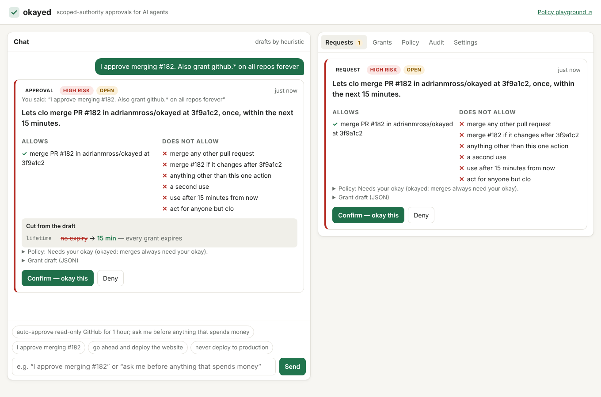

# okayed

**Scoped-authority approvals for AI agents.** People tell their agents things like *"I approve merging #182"* or
*"go ahead and deploy the website"*. Nothing can verify a sentence like that. okayed turns it into the **narrowest
exact, signed, expiring grant** it can mean, shows that grant to the person to confirm, and lets any tool verify the
grant before it acts.

> "I approve merging #182" → **Lets assistant merge PR #182 in adrianmross/okayed at 3f9a1c2, once, within the next 15
> minutes.** It does not cover any other PR, a newer commit, a second use, or any other agent.

- **Web app:** _deployed link goes here_ · **Playground:** _deployed link goes here_
- Runs on Cloudflare: Workers AI (Llama 3.3), Agents SDK, a Durable Object per user, Workflows, and Pages. The core
  is provider-agnostic.
- MIT licensed. The full prompt history behind this AI-assisted build is in [`PROMPTS.md`](PROMPTS.md).



## Why

Agents act under borrowed authority. Today that authority is a long-lived token plus a sentence in a chat log. The
agent decides what the sentence meant, and the tool trusts the agent. okayed makes the authority explicit and
answers three questions in miniature:

1. **Who is the agent acting for?** The grant is issued by the person's key (`iss`) to one agent (`aud`).
2. **What can it touch?** One action on exact targets: repo + PR + commit SHA, or site + environment. No wildcards.
3. **How do you take it back?** Every grant expires on its own. You can revoke any grant at any time, and an
   emergency stop revokes them all.

## How it works

```mermaid
sequenceDiagram
    autonumber
    participant A as Agent (e.g. Assistant)
    participant W as okayed Worker
    participant DO as OkayedAgent<br/>(Durable Object per user)
    participant WF as GrantLifecycle<br/>(Workflow)
    participant LLM as Llama 3.3<br/>(Workers AI)
    participant P as Person (Pages UI)
    participant T as Tool (GitHub merge)

    A->>W: POST /requests {act, res, why}
    W->>DO: submitRequest
    DO->>DO: engine: bind + narrow + decide (pure)
    DO->>WF: start flow (propose → await confirm)
    DO-->>P: card over WebSocket: sentence, allows / does not, risk
    P->>W: "I approve merging #182"
    W->>DO: chat
    DO->>LLM: draft a grant (JSON)
    LLM-->>DO: proposal (untrusted)
    DO->>DO: engine cuts it to what was said, shows what it cut
    P->>W: Confirm
    DO->>WF: event: decision=confirm
    WF->>DO: issue → signed kind 4841, NIP-40 expiration
    A->>W: GET /requests/:id → grant event
    A->>T: merge #182 with the grant
    T->>DO: verify + consume (atomic; once means once)
    T->>T: swap in the real token, merge at the pinned SHA
    WF->>DO: at exp: expire (or end early on revoke)
```

**The model drafts; a deterministic engine decides.** Llama 3.3 does two things: it turns plain language into a
*proposed* grant or policy, and it explains requests in plain words. Allow and deny, narrowing, risk, lifetimes and
use counts all come from pure, tested TypeScript in [`packages/engine`](packages/engine). The engine treats the
model's output as hostile input. A prompt injection can at most make the model propose something the engine then
cuts, and the cut is shown on the card ("asked for X, granted Y, refused Z because …").

### Design rules, and where each one lives

| Rule | Where |
|---|---|
| Least privilege by construction: exact targets, shortest reasonable lifetime, fewest uses | `engine/src/narrow.ts`, `engine/src/catalog.ts` |
| Never broader than what the person said. Every pinned value comes from their words or the one request they point at | `engine/src/anchors.ts`, `narrowGrant` |
| Ambiguity is a question ("Which site?", "Which environment?", "Which commit?") | `bind` / `bindFromWords` in `narrow.ts` |
| Standing policies for repeat actions, bounded by horizon, count, risk budget and conditions; each use is still its own exact grant | `engine/src/policy.ts`, `core/src/service.ts` |
| Layered policy: each layer can only narrow the one above; the reason names the first layer that refuses | `engine/src/policy.ts` |
| "Once" means exactly one use: the Durable Object decrements inside a storage transaction | `OkayedService.verify` |
| Revocable at any time; expiry enforced by the Workflow and by verifiers | `core/src/flow.ts`, `engine/src/use.ts` |
| The agent never sees the GitHub token: the Worker swaps it in only under a live grant | `core/src/github.ts` |

The grant format (JSON, JCS-hashed id, signed as a Nostr event, kinds 4840–4844 and 34840) is specified in
[`docs/grant-format.md`](docs/grant-format.md). The design notes are in [`docs/design.md`](docs/design.md).

## Standing policies

A one-time okay is the narrow case. Most of the time you want an agent to get on with things:

> “let assistant merge anything in okayed when checks pass for 2 weeks, up to 30 merges”

That becomes a standing policy: agent `assistant`, repo `adrianmross/okayed`, condition `checks.pass`, a 14-day horizon
and a limit of 30. Each merge under it is auto-approved as its own once-only grant, pinned to the PR's head commit,
and the grant names the policy that allowed it.

**Budgets are optional.** Put one on a single policy ("up to 30 merges"), or add a shared budget across policies:
global ("everything, 100 risk this week"), for one action ("merges, 10 a day") or for one agent ("assistant, 50 risk
this week, counting my own okays too"). When a budget runs out, the next request asks you, the card says what spent
it, and one tap tops it up.

New users start with a **balanced posture** and no budgets: reads, comments, merges with passing checks, and staging
deploys go ahead; production deploys and spending ask. These are ordinary rules you can change in the Policy tab, by
tapping a pill, or in words. The model's draft of a policy can't widen what you said.

## Repository layout

```
packages/engine      pure decision engine: anchors, binding, narrowing, policy, use checks (79 tests)
packages/grant       grant format v0: JCS, ids, Nostr events, BIP-340 signatures, per-user issuer keys
packages/core        provider-neutral service behind ports (Store, Signer, Drafter, Lifecycle, Vault, Clock),
                     the lifecycle flow, prompts, a model-free drafter, in-memory adapters, the GitHub tool
apps/worker          Cloudflare: Agents SDK agent (Durable Object per user), Workflow, Workers AI drafter, HTTP API
packages/client      a dependency-free client for agents: ask, wait, merge
packages/ui          shared DOM components and styles for both UIs (flat blocks)
apps/web             Pages: Now (requests + chat), Grants, Policy, Activity, Setup; Debug switch for raw detail
apps/playground      Pages: the engine in the browser; policy what-ifs and the narrowing demo
apps/mcp             MCP server so Assistant or any MCP agent asks okayed before acting
docs/                design notes and the grant format
scripts/smoke.mjs    end-to-end check against a running Worker
```

## Run it locally

Requires Node 22 and pnpm 10.

```bash
pnpm install
pnpm test                      # engine, grant, core and worker tests
cp apps/worker/.dev.vars.example apps/worker/.dev.vars
# put 64 hex chars in ISSUER_SECRET:  node -e "console.log(require('crypto').randomBytes(32).toString('hex'))"
pnpm dev:local                 # the Worker on :8787, Durable Objects + Workflows, no Cloudflare login
pnpm dev:web                   # chat UI on :5173
pnpm dev:playground            # playground on :5174
node scripts/smoke.mjs         # request → approve in words → grant → first use OK → second use refused
```

`dev:local` runs every part except Workers AI, using the model-free `HeuristicDrafter`. The engine binds grants from
your words either way, so the whole flow works offline. To use Llama 3.3, run `wrangler login` and then
`pnpm dev:worker`. The model's drafts still go through the same engine.

### Talk to it like an agent

```bash
API=http://localhost:8787
# In the web app: Settings → Add agent → copy the token. Or:
read U OWNER < <(curl -s -X POST $API/api/users | node -pe 'const j=JSON.parse(require("fs").readFileSync(0));j.userId+" "+j.ownerToken')
AGENT=$(curl -s -X POST $API/api/u/$U/agents -H "authorization: Bearer $OWNER" -d '{"name":"assistant"}' | node -pe 'JSON.parse(require("fs").readFileSync(0)).token')

# 1. The agent asks.
curl -s -X POST $API/api/u/$U/requests -H "authorization: Bearer $AGENT" \
  -d '{"act":"github.pr.merge","res":["github:adrianmross/okayed/pull/182@3f9a1c2e4b5d6f708192a3b4c5d6e7f801234567"],"why":"reviewed, CI green"}'

# 2. The person says yes in the web app ("I approve merging #182"), or:
curl -s -X POST $API/api/u/$U/chat -H "authorization: Bearer $OWNER" -d '{"text":"I approve merging #182"}'
curl -s -X POST $API/api/u/$U/cards/<card id>/confirm -H "authorization: Bearer $OWNER"

# 3. The agent collects the signed grant (long-polls up to 20 s).
curl -s "$API/api/u/$U/requests/<request id>?wait=10" -H "authorization: Bearer $AGENT"

# 4. A tool verifies before acting. "consume": true spends a use atomically.
curl -s -X POST $API/api/u/$U/verify -d '{"event":<grant event>,"aud":"agent:assistant","act":"github.pr.merge","res":"github:…","consume":true}'
```

Or let okayed perform the action: `POST /api/u/:user/tools/github/merge {grant, owner, repo, number, sha}`. The
Worker verifies and consumes the grant, checks `checks.pass` when the grant requires it (without spending the use if
the checks fail), then merges with its own `GITHUB_TOKEN`, passing GitHub's `sha` guard so a moved head is refused.
The agent never holds the token.

### Use it from Assistant, or any MCP agent

`apps/mcp` is an MCP server with four tools:

- `okayed_actions` lists the actions and how to name exact targets.
- `okayed_request` asks before acting. It returns at once if a standing policy allows the action; otherwise it waits for you.
- `okayed_status` keeps waiting on a request.
- `okayed_merge_pr` merges through okayed's tool.

Grants stay inside the MCP process, so the agent sees what it may do but never holds a credential.

```json
{
  "mcpServers": {
    "okayed": {
      "command": "node",
      "args": ["/path/to/okayed/apps/mcp/src/main.ts"],
      "env": { "OKAYED_API": "https://okayed.<you>.workers.dev", "OKAYED_USER": "<user id>", "OKAYED_TOKEN": "agt_…" }
    }
  }
}
```

For code that isn't an MCP agent, `packages/client` does the same in a few lines:

```ts
const okayed = new OkayedClient({ api, user, token });
const a = await okayed.ask("github.pr.merge", [prResource("adrianmross", "okayed", 182, sha)], "CI is green");
if (a.status === "granted") await okayed.merge(a.event!, { owner: "adrianmross", repo: "okayed", number: 182, sha });
```

## Deploy (Cloudflare)

Everything here runs on the free plan: Workers, Durable Objects (SQLite), Workflows, the Workers AI free
allocation, and Pages.

```bash
cd apps/worker
npx wrangler login
npx wrangler deploy
node -e "console.log(require('crypto').randomBytes(32).toString('hex'))" | npx wrangler secret put ISSUER_SECRET
npx wrangler secret put GITHUB_TOKEN        # optional: fine-grained, PR write on the demo repo only

cd ../..
VITE_API_BASE=https://okayed.<you>.workers.dev VITE_PLAYGROUND_URL=https://okayed-playground.pages.dev pnpm --filter @okayed/web build
VITE_WEB_URL=https://okayed.pages.dev pnpm --filter @okayed/playground build
npx wrangler pages deploy apps/web/dist --project-name okayed
npx wrangler pages deploy apps/playground/dist --project-name okayed-playground
```

Or add the `CLOUDFLARE_API_TOKEN`, `CLOUDFLARE_ACCOUNT_ID` and `ISSUER_SECRET` repository secrets and run the
**deploy** workflow.

## Cloudflare assignment checklist

| Requirement | Here |
|---|---|
| LLM | Llama 3.3 70B on Workers AI (`@cf/meta/llama-3.3-70b-instruct-fp8-fast`), JSON-schema mode, for drafting and explaining (`apps/worker/src/adapters.ts`) |
| Workflow / coordination | Agents SDK `Agent` as a Durable Object per user; `AgentWorkflow` for request → propose → await confirm → issue → expire/revoke (`apps/worker/src/workflow.ts`) |
| User input | Chat on Pages (`apps/web`), with live state over the Agents SDK WebSocket. Voice via Realtime is a stretch goal and not built. |
| Memory / state | Per-user policy layer, pending requests, cards, grants with use counters, audit log and chat, in Durable Object storage |

## Not tied to Cloudflare

Only `apps/worker` imports Cloudflare APIs. The service in `packages/core` depends on six small ports. The flow
(`runGrantFlow`) is written once, and both Workflows and the in-memory runtime run it. Moving to another provider
means implementing `Store` (needs a serializable transaction, e.g. a Postgres row lock), `Lifecycle` (Temporal, or a
queue plus timers), `Drafter` (any chat model that can return JSON), `Signer` (KMS or HSM) and `Vault`. The core
test suite already runs the whole flow (request, confirm, issue, once-only use, revoke, expiry, emergency stop) on
the in-memory adapters in Node.

## Fits with OpenMeadow, Buzz and Assistant

- **OpenMeadow's thesis in miniature:** who the agent acts for (`iss` → `aud`), what it can touch (`act` + exact
  `res`), and how you take it back (`exp`, revoke, emergency stop).
- **Nostr:** grants, revokes and receipts are ordinary signed Nostr events with NIP-40 expiration, so any
  relay can carry them as they are. The `assurance` field is where a proof from another approver can
  plug in later, replacing today's `web-click`.
- **Assistant:** the first agent to wire up. Assistant calls `POST /requests` before a merge or deploy, waits for the grant, and
  calls the merge tool. Assistant never holds a GitHub token.

## Limitations (v0)

- Identity is a bearer owner token per user and minted agent tokens. There are no accounts and no passkeys yet.
  `assurance` records `web-click`.
- One action per grant. There are no delegation chains, and events are not yet published to relays.
- `POST /verify` with `consume: true` requires the grant event, not just its id. Anyone holding the event can spend
  its use, which is safe for the intended flow (agent → tool) but is not proof of who the caller is.
- Learned PR heads come from agent requests unless `GITHUB_TOKEN` is set. With the token, the Worker checks the head
  against GitHub and refuses a mismatch.
- Event kinds 4840–4844 and 34840 are placeholders, not registered NIPs.

## License

[MIT](LICENSE) © 2026 Adrian Ross
