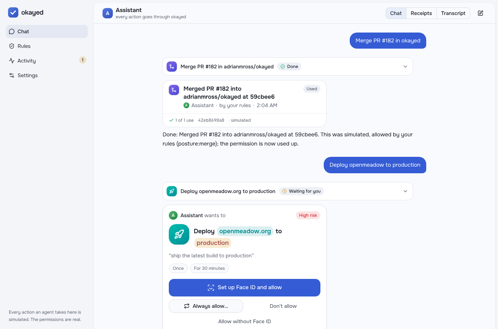
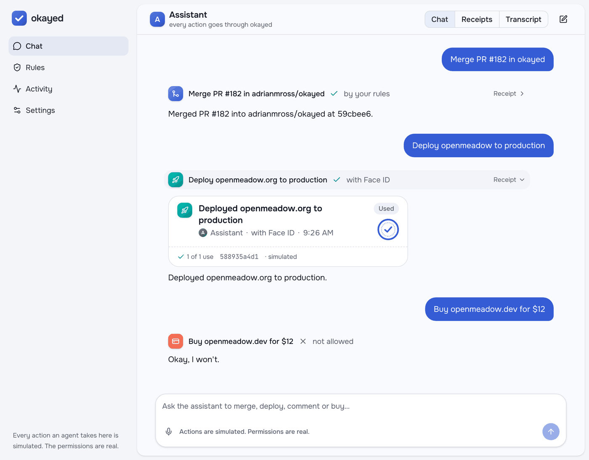
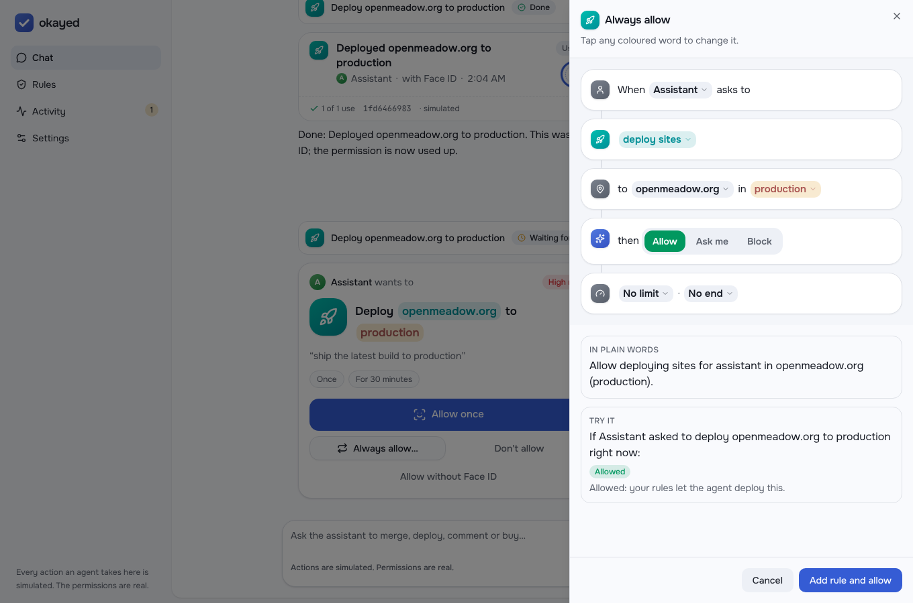
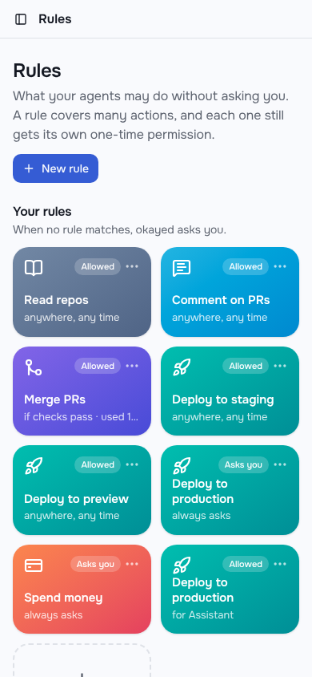
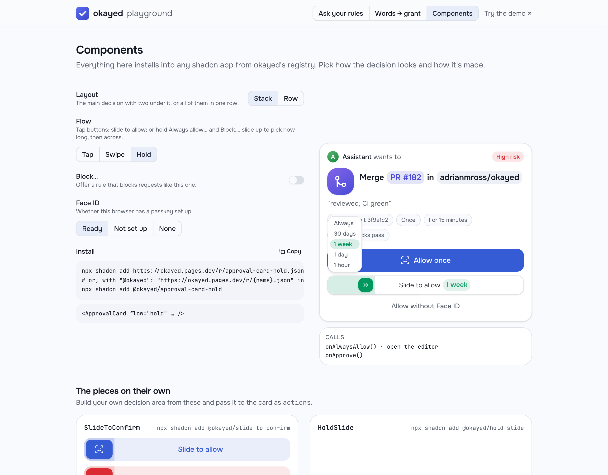
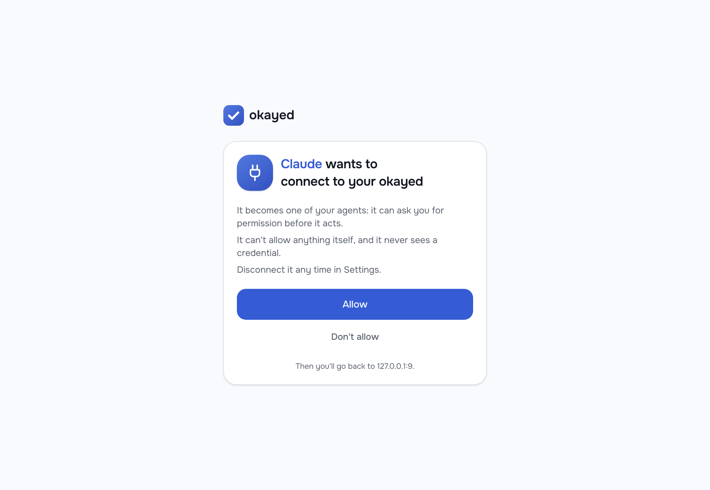
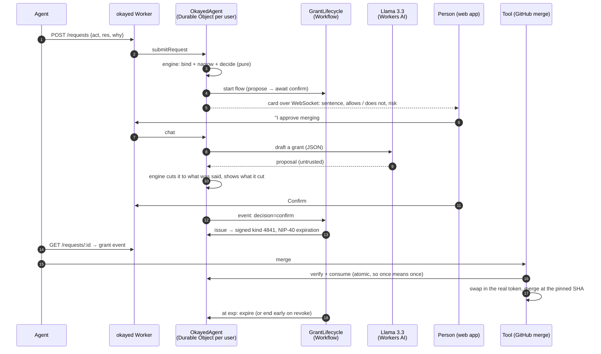
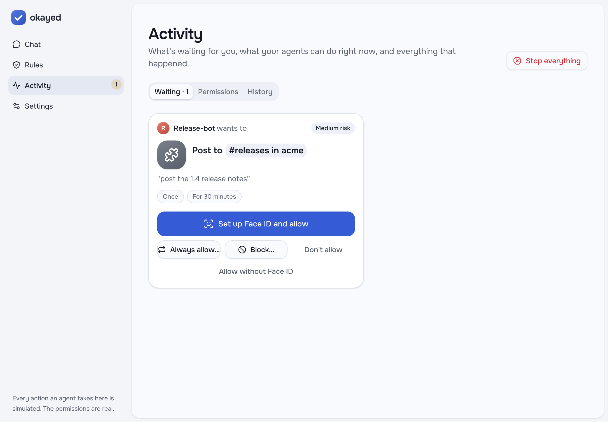

# okayed

**Scoped-authority approvals for AI agents.** People tell their agents things like *"I approve merging #182"* or
*"go ahead and deploy the website"*. Nothing can verify a sentence like that. okayed turns it into the **narrowest
exact, signed, expiring grant** it can mean, shows that grant to the person to confirm, and lets any tool verify the
grant before it acts.

> "I approve merging #182" → **Lets assistant merge PR #182 in adrianmross/okayed at 3f9a1c2, once, within the next 15
> minutes.** It does not cover any other PR, a newer commit, a second use, or any other agent.

- **Web demo:** _deployed link goes here_ · **Playground:** _deployed link goes here_
- Runs on Cloudflare, as one Worker: Workers AI (Llama 3.3, Whisper), the Agents SDK (a Durable Object per user,
  `AIChatAgent` for the chat, `McpAgent` for remote MCP), Workflows, Queues, KV, Analytics Engine, rate limiting,
  Access, Turnstile, AI Gateway and static assets. See [Cloudflare, end to end](#cloudflare-end-to-end). The core is
  provider-agnostic, and the components install into any shadcn app.
- MIT licensed. The prompts behind this AI-assisted build are in [`PROMPTS.md`](PROMPTS.md).

## The demo

Chat with an assistant that can merge pull requests, deploy sites, comment and buy things. Its tools are simulated:
nothing real happens. Every tool call still goes through okayed, and the permissions it signs are real.

- If your rules allow the call, it goes ahead with a one-time permission, and a receipt appears in the chat.
- If they ask you, an approval card appears under the tool call: the plain sentence, the exact scope, the risk, and
  what was left out of the draft. **Allow once** signs a WebAuthn assertion (Face ID, Touch ID) over that exact
  request, and the assertion travels with the permission. **Always allow…** opens the narrowest rule that covers
  requests like this one, and allows this one with the same Face ID.
- If a rule blocks it, the assistant is refused and says so.

Approval buttons come in two layouts (stacked, or in a row) and three ways to decide: tap, swipe to allow, or
**hold and slide**. Press Always allow… or Block…, slide up to choose how long the rule lasts (an hour up to always),
then across to confirm. Pick yours in Settings. You can also **say** what you want: the mic hears you through
Whisper on Workers AI, and the words land in the box for you to read before sending.

Each conversation has three views: **Chat**, **Receipts** and **Transcript** (every tool input and output, okayed
request and grant, as data). **Rules** is a library you build like Siri Shortcuts. **Activity** has what's waiting,
the permissions agents hold right now (take any of them back), and a history of signed receipts.

| The assistant asks; you allow it with Face ID | Then it carries on, with receipts |
|---|---|
|  |  |

| “Always allow…” opens the narrowest rule | Your rules, on a phone |
|---|---|
|  |  |

| Hold and slide: up for how long, across to confirm | An MCP client asks to connect |
|---|---|
|  |  |

**Words.** The app speaks in everyday words. The API, the grant format and the docs keep the IAM ones:

| In the app | In the API and docs |
|---|---|
| a **request** ("Assistant wants to…") | request (kind 4840) |
| **Allow** · **Ask me** · **Block** | `allow` · `ask` · `deny` |
| a **rule** | a rule in your layer of the policy |
| a **permission** | a grant (kind 4841) |
| a **receipt** | a use receipt (kind 4843) |
| a **limit**, in uses or points | a budget (`budget`, `budgets`) |
| **Take back** · **Stop everything** | revoke (4842) · emergency stop (4844) |

## Why

Agents act under borrowed authority. Today that authority is a long-lived token plus a sentence in a chat log. The
agent decides what the sentence meant, and the tool trusts the agent. okayed makes the authority explicit and
answers three questions in miniature:

1. **Who is the agent acting for?** The grant is issued by the person's key (`iss`) to one agent (`aud`).
2. **What can it touch?** One action on exact targets: repo + PR + commit SHA, or site + environment. No wildcards.
3. **How do you take it back?** Every grant expires on its own. You can revoke any grant at any time, and an
   emergency stop revokes them all.

## How it works



**The model drafts; a deterministic engine decides.** Llama 3.3 does two things: it turns plain language into a
*proposed* grant or policy, and it explains requests in plain words. Allow and deny, narrowing, risk, lifetimes and
use counts all come from pure, tested TypeScript in [`packages/engine`](packages/engine). The engine treats the
model's output as hostile input. A prompt injection can at most make the model propose something the engine then
cuts, and the cut is shown on the card ("asked for X, granted Y, refused Z because …").

### Design rules, and where each one lives

| Rule | Where |
|---|---|
| Least privilege by construction: exact targets, shortest reasonable lifetime, fewest uses | `engine/src/narrow.ts`, `engine/src/catalog.ts` |
| Never broader than what the person said. Every pinned value comes from their words or the one request they point at | `engine/src/anchors.ts`, `narrowGrant` |
| Ambiguity is a question ("Which site?", "Which environment?", "Which commit?") | `bind` / `bindFromWords` in `narrow.ts` |
| Standing policies for repeat actions, bounded by horizon, count, risk budget and conditions; each use is still its own exact grant | `engine/src/policy.ts`, `core/src/service.ts` |
| Layered policy: each layer can only narrow the one above; the reason names the first layer that refuses | `engine/src/policy.ts` |
| "Once" means exactly one use: the Durable Object decrements inside a storage transaction | `OkayedService.verify` |
| Revocable at any time; expiry enforced by the Workflow and by verifiers | `core/src/flow.ts`, `engine/src/use.ts` |
| The agent never sees the GitHub token: the Worker swaps it in only under a live grant | `core/src/github.ts` |

The grant format (JSON, JCS-hashed id, signed as a Nostr event, kinds 4840–4844 and 34840) is specified in
[`docs/grant-format.md`](docs/grant-format.md). The design notes are in [`docs/design.md`](docs/design.md).

## Standing rules

A one-time okay is the narrow case. Most of the time you want an agent to get on with things:

> “always allow merges in okayed when checks pass for 2 weeks, up to 30 merges”

That becomes a rule: repo `adrianmross/okayed`, condition `checks.pass`, a 14-day horizon and a limit of 30. Each
merge under it is allowed as its own one-time permission, pinned to the PR's head commit, and the permission names
the rule that allowed it. **Always allow…** on an approval card builds the same kind of rule from a real request.

**Limits are optional.** Put one on a single rule ("up to 30 merges"), or add a limit shared across rules: global
("everything, 100 points this week"), for one action ("merges, 10 a day") or for one agent ("the assistant, 50 points
this week, counting what I allow too"). Points weigh actions by risk. When a limit runs out, the next request asks
you, the card says what used it up, and one tap resets it.

New users start from the **Balanced** preset and no limits: reads, comments, merges with passing checks, and staging
deploys are allowed; production deploys and spending ask. These are ordinary rules you can change in Rules, by
tapping a word, or in words. The model's draft of a rule can't widen what you said.

## Approvers

Every approval signs the same thing: the card, a hash of its exact draft, and a nonce. Today the approver is local, a
passkey in the browser. The approver is a port, so an approval can also go to an app on another device, such as a
phone: pair the app's public key (`POST /approvers`), and okayed keeps what's waiting in an inbox the app reads with
a signed request (NIP-98). The app answers with a signed approval event (kind 4845), which becomes the grant's proof
(`assurance.method: "approver"`). A `Notifier` port can wake the app; the wake carries nothing. okayed's side is
built and tested end to end. No app ships with it yet.

## Interpreting people

The model only drafts, so it never decides, but a better reader asks fewer needless questions. `packages/core`
drafts with Workers AI (Llama 3.3 by default), or any OpenAI-compatible endpoint (`DRAFTER=openai-compatible`), and
falls back to the model-free heuristic. Twenty eval cases, from plain okays to prompt injections, are scored by what
the engine ends up doing with each draft:

```bash
pnpm --filter @okayed/core test interpret                     # the heuristic: 18/20 intent, 17/20 outcome
EVAL_MODELS="cf:@cf/meta/llama-3.3-70b-instruct-fp8-fast,cf:@cf/openai/gpt-oss-120b" \
  CLOUDFLARE_ACCOUNT_ID=… CLOUDFLARE_API_TOKEN=… pnpm --filter @okayed/core test interpret
EVAL_MODELS="openai:gpt-5-mini" OPENAI_API_KEY=… pnpm --filter @okayed/core test interpret
```

Part of the work is a bounded choice (is this an okay, a rule or a question; which pending request; which site), and
the intent column scores it on its own. Fast decision models, such as OpenAI's Decisions API, fit that part. See
[`docs/design.md`](docs/design.md#interpreting-people).

## Repository layout

```
packages/engine      pure decision engine: anchors, binding, narrowing, standing policies, budgets, use checks
packages/grant       grant format v0: JCS, ids, Nostr events, BIP-340 signatures, per-user issuer keys
packages/core        the platform-neutral service: ports (Store, Signer, Drafter, Lifecycle, Clock, Notifier), the
                     HTTP API on Request/Response, identity (OIDC, workload identity), connectors and credentials,
                     capability pack setup, approvers (passkeys, paired apps), drafters, the demo's tools, evals
packages/connectors  GitHub (token or GitHub App), Cloudflare (Pages, DNS, just-in-time tokens), Slack
packages/design      okayed's design system: tokens, the latest shadcn components, AI Elements for chat, and
                     okayed's approval card, receipts, rule tiles and Shortcuts-style editor, also served as a
                     shadcn registry (docs/design-system.md)
packages/client      a dependency-free client for agents: ask, wait, merge
apps/worker          Cloudflare: OkayedAgent (Durable Object per user), OkayedChat (AIChatAgent), OkayedMcp
                     (remote MCP over OAuth), the Workflow, Workers AI, Access, Queues, the API and the site
apps/web             the demo (Chat, Rules, Activity, Settings), React on @okayed/design, and /r/ (the registry)
apps/playground      at /playground: ask your rules, build one, see every component configuration, and watch words
                     narrow into a grant; the engine in the browser
apps/node            the same API on Node: SQLite, in-process timers, no build step
apps/mcp             MCP server so any MCP agent asks okayed before acting
docs/                design notes, grant format, design system
scripts/             smoke.mjs (API end to end), mcp-remote.mjs (OAuth and MCP), e2e-web.mjs (the demo in a browser)
```

## Run it locally

Requires Node 22 and pnpm 10.

```bash
pnpm install
pnpm test                      # engine, grant, core, client, MCP and worker tests
cp apps/worker/.dev.vars.example apps/worker/.dev.vars
# put 64 hex chars in ISSUER_SECRET:  node -e "console.log(require('crypto').randomBytes(32).toString('hex'))"
pnpm build:site                # the web app, the playground (/playground) and the registry (/r), for the Worker
pnpm dev:local                 # one Worker on :8787 serves all of it, with no Cloudflare login
pnpm e2e                       # the API, remote MCP over OAuth, then the demo in a browser with a virtual Face ID
```

Open <http://localhost:8787>. For hot reload while working on the UI, run `pnpm dev:web` (:5173) and
`pnpm dev:playground` (:5174) next to the Worker.

`dev:local` runs every part except Workers AI: Durable Objects, the Workflow, OAuth and remote MCP, Queues, R2 and
the static site are all simulated locally. The assistant is then played by a scripted model that reads intent with
okayed's own anchors, and drafting uses the model-free `HeuristicDrafter`, so the whole demo works offline. To use
Llama 3.3 and voice, run `wrangler login` and then `pnpm dev:worker`. The model only drafts; okayed still decides.

Face ID works on `localhost`: browsers treat it as a secure context. Passkeys are bound to the Worker's own origin
and to any origin in `WEB_ORIGINS`.

### Talk to it like an agent

```bash
API=http://localhost:8787
# In the web app: Settings → Add agent → copy the token. Or:
read U OWNER < <(curl -s -X POST $API/api/users | node -pe 'const j=JSON.parse(require("fs").readFileSync(0));j.userId+" "+j.ownerToken')
AGENT=$(curl -s -X POST $API/api/u/$U/agents -H "authorization: Bearer $OWNER" -d '{"name":"assistant"}' | node -pe 'JSON.parse(require("fs").readFileSync(0)).token')

# 1. The agent asks.
curl -s -X POST $API/api/u/$U/requests -H "authorization: Bearer $AGENT" \
  -d '{"act":"github.pr.merge","res":["github:adrianmross/okayed/pull/182@3f9a1c2e4b5d6f708192a3b4c5d6e7f801234567"],"why":"reviewed, CI green"}'

# 2. The person says yes in the web app ("I approve merging #182"), or:
curl -s -X POST $API/api/u/$U/chat -H "authorization: Bearer $OWNER" -d '{"text":"I approve merging #182"}'
curl -s -X POST $API/api/u/$U/cards/<card id>/confirm -H "authorization: Bearer $OWNER"

# 3. The agent collects the signed grant (long-polls up to 20 s).
curl -s "$API/api/u/$U/requests/<request id>?wait=10" -H "authorization: Bearer $AGENT"

# 4. A tool verifies before acting. "consume": true spends a use atomically.
curl -s -X POST $API/api/u/$U/verify -d '{"event":<grant event>,"aud":"agent:assistant","act":"github.pr.merge","res":"github:…","consume":true}'
```

Or let okayed perform the action: `POST /api/u/:user/tools/github/merge {grant, owner, repo, number, sha}`. The
Worker verifies and consumes the grant, checks `checks.pass` when the grant requires it (without spending the use if
the checks fail), then merges with its own `GITHUB_TOKEN`, passing GitHub's `sha` guard so a moved head is refused.
The agent never holds the token.

### Use it from any MCP agent

okayed is a **remote MCP server** at `/mcp`. Add `https://<your okayed>/mcp` to Claude, Cursor or any MCP client. The
client registers itself and sends you to okayed's Connect screen; allowing it makes the client one of your agents.
Its OAuth token can ask for permission and use what it's given, and nothing else. Disconnect it in Settings.

The tools:

- `okayed_actions` lists the actions and how to name exact targets.
- `okayed_request` asks before acting. It returns at once if one of your rules allows the action; otherwise it waits for you.
- `okayed_status` keeps waiting on a request.
- `okayed_merge_pr` merges through okayed's tool.
- `okayed_deploy_site` deploys through okayed's tool (Cloudflare Pages, below).

Grants stay inside okayed (or the MCP process), so the agent sees what it may do but never holds a credential.

For a local agent, `apps/mcp` runs the same tools over stdio with a token from Settings:

```json
{
  "mcpServers": {
    "okayed": {
      "command": "node",
      "args": ["/path/to/okayed/apps/mcp/src/main.ts"],
      "env": { "OKAYED_API": "https://okayed.<you>.workers.dev", "OKAYED_USER": "<user id>", "OKAYED_TOKEN": "agt_…" }
    }
  }
}
```

For code that isn't an MCP agent, `packages/client` does the same in a few lines:

```ts
const okayed = new OkayedClient({ api, user, token });
const a = await okayed.ask("github.pr.merge", [prResource("adrianmross", "okayed", 182, sha)], "CI is green");
if (a.status === "granted") await okayed.merge(a.event!, { owner: "adrianmross", repo: "okayed", number: 182, sha });
```

## Deploy (Cloudflare)

Everything runs on the free plan. One command builds the site, creates the queue and deploys the Worker; KV is created
on first deploy.

```bash
cd apps/worker
npx wrangler login
pnpm run deploy
node -e "console.log(require('crypto').randomBytes(32).toString('hex'))" | npx wrangler secret put ISSUER_SECRET
```

Or add the `CLOUDFLARE_API_TOKEN`, `CLOUDFLARE_ACCOUNT_ID` and `ISSUER_SECRET` repository secrets and run the
**deploy** workflow. Optional, each off until you set it:

| To | Set |
|---|---|
| Sign in with **Cloudflare Access** instead of an owner token | Put an Access application in front of the Worker; vars `ACCESS_TEAM` (your `<team>.cloudflareaccess.com`) and `ACCESS_AUD` (the application's AUD tag) |
| Check sign-ups with **Turnstile** | Secret `TURNSTILE_SECRET`; build with `VITE_TURNSTILE_SITE_KEY` |
| Route model calls through **AI Gateway** (logs, caching, rate limits) | Var `AI_GATEWAY` (the gateway id) |
| **Real deploys** with just-in-time API tokens | Secret `CF_API_TOKEN` (permission: Account API Tokens: Edit, nothing else); vars `CF_ACCOUNT_ID` and `CF_PAGES_SITES`, e.g. `{"okayed.dev":{"project":"okayed-site","branches":{"production":"main","staging":"staging"}}}` |
| Archive every signed event to **R2** | Uncomment `r2_buckets` in `wrangler.jsonc` (R2 needs billing enabled on the account) |
| Merge real PRs | A GitHub App (vars `GITHUB_APP_ID`, `GITHUB_APP_INSTALLATION`, secret `GITHUB_APP_KEY`), or secret `GITHUB_TOKEN`: fine-grained, pull-request write on the demo repo only |
| Sign in with **another OIDC provider** | Vars `OIDC_ISSUER` and `OIDC_AUDIENCE`; the provider's ID token is the bearer token |
| Approve **other services' actions** | Var `CAPABILITY_PACKS` (e.g. `slack,email,cloudflare-dns,aws-s3`) or `CAPABILITY_PACKS_JSON` |
| Post to **Slack** | Secret `SLACK_BOT_TOKEN`, var `SLACK_WORKSPACE`, and the `slack` pack |
| Change **DNS** with zone-scoped tokens | Var `CF_DNS_ZONES` (`{"okayed.dev":"<zone id>"}`), with `CF_ACCOUNT_ID`, `CF_API_TOKEN` and the `cloudflare-dns` pack |

### Use the components in your own app

The Worker also serves okayed's design system as a [shadcn registry](https://ui.shadcn.com/docs/registry) at `/r/`:
the theme, the engine, each component, and examples of each approval-button configuration. Item URLs carry the
origin they're served from, so the registry works on any domain.

```bash
npx shadcn add https://<your okayed>/r/approval-card.json
# or add "@okayed": "https://<your okayed>/r/{name}.json" to "registries" in components.json, then:
npx shadcn add @okayed/okayed @okayed/approval-card-hold
```

The playground's Components view shows every configuration live, with its install command.

## Cloudflare, end to end

| Cloudflare | What it does here | Where |
|---|---|---|
| Workers + static assets | One Worker: the API, the web app, the playground and the registry, on one origin | `apps/worker/src/index.ts`, `api.ts` |
| Durable Objects (SQLite) | A person's okayed (policy, requests, grants, use counters, audit), their chat, and each MCP session | `agent.ts`, `chat.ts`, `mcp.ts` |
| Workflows | Each grant's lifecycle: propose, await the person, issue, expire or revoke | `workflow.ts` |
| Agents SDK | `Agent` with live state over WebSocket, `AIChatAgent` with tool approval, `McpAgent` for remote MCP | `agent.ts`, `chat.ts`, `mcp.ts` |
| Workers AI | Llama 3.3 drafts and explains; Whisper hears voice okays | `adapters.ts`, `chat.ts`, `agent.ts` |
| AI Gateway | Optional: every model call logged, cached and rate limited | `AI_GATEWAY` |
| KV + Workers OAuth Provider | OAuth for remote MCP clients: registration, consent, tokens | `consent.ts`, `index.ts` |
| Access | Optional: your Access identity is your okayed; no owner token | `access.ts` |
| Turnstile | Optional: a quiet human check on sign-up | `api.ts`, `welcome.tsx` |
| Rate limiting | Sign-ups per address, requests per agent | `wrangler.jsonc`, `api.ts` |
| Queues | Wakes paired approver apps, so a slow app never holds up a request | `notify.ts` |
| Analytics Engine | One data point per request, issue and deploy | `agent.ts` (`metric`) |
| R2 | Optional: an archive of every signed event | `agent.ts` (`archiveEvents`) |
| API tokens | Real deploys: a Pages-only token minted per deploy, dead within ten minutes, deleted after use | `cloudflare.ts` |
| Workers Logs | Observability for the Worker | `wrangler.jsonc` |

## Cloudflare assignment checklist

| Requirement | Here |
|---|---|
| LLM | Llama 3.3 70B on Workers AI (`@cf/meta/llama-3.3-70b-instruct-fp8-fast`): the demo assistant's tool calling (`apps/worker/src/chat.ts`), plus drafting and explaining approvals and rules (`adapters.ts`); Whisper for voice |
| Workflow / coordination | Agents SDK: `OkayedAgent` (a Durable Object per user) and `OkayedChat` (`AIChatAgent`, per user); `AgentWorkflow` for request → propose → await confirm → issue → expire/revoke |
| User input | Chat (`apps/web`, served by the Worker), with AI SDK tool approval wired to okayed and live state over the Agents SDK WebSocket. Voice: speak in the chat, transcribed by Whisper on Workers AI (not Realtime). |
| Memory / state | Chat history in `OkayedChat`'s SQLite; rules, limits, requests, grants with use counters, passkeys, paired approvers and the audit log in `OkayedAgent`; OAuth state in KV; optionally every signed event in R2 |

## Built to plug into anything

The core doesn't know about Cloudflare, GitHub or any one sign-in. Each of those plugs in.

**Any runtime.** `packages/core` holds the service and its whole HTTP API on the Fetch API's `Request` and
`Response`, and uses only TypeScript syntax that can be stripped, so Node, Deno and Bun run it as is. Two runtimes
ship: the Cloudflare Worker (a Durable Object serves the API) and `apps/node` (SQLite and timers). The API smoke test
runs against both.

```bash
OKAYED_SECRET=$(openssl rand -hex 32) node apps/node/src/main.ts      # okayed on Node, on :8788
```

To port it elsewhere, implement `Store` (a serializable transaction per person: a Durable Object, SQLite, a Postgres
row lock), `Lifecycle` (Workflows, timers, Temporal), and pick a `Drafter` (Workers AI, any OpenAI-compatible
model, or none).

**Any action, as data.** A capability pack declares a service's actions (risk, lifetimes, use counts, the words
people use for them) and its resource types as templates. Registered, its actions get everything the built-in ones
do: rules, decisions, narrowing, explanations, Face ID, signed grants and receipts.

```ts
registerPack({
  id: "linear", title: "Linear",
  resources: [{ kind: "linear.issue", template: "linear:{team}/{issue}", label: "{issue|upper} in {team}" }],
  actions: [{ act: "linear.issue.close", verb: "close", noun: "closing Linear issues", risk: "medium",
              ttl: 1800, maxTtl: 7200, uses: 1, maxUses: 10, res: ["linear.issue"], keywords: ["close"] }],
});
```

Example packs ship for Slack, email, Cloudflare DNS and S3; turn them on with `CAPABILITY_PACKS=slack,email,…` or
bring your own with `CAPABILITY_PACKS_JSON`.



**Any service, with the least credential.** A connector does one thing under a grant: it checks the grant without
spending it (looking up any facts its conditions need), spends one use, acts and releases its credential. A
credential is either a stored secret or minted for that call alone:

| Connector | Credential |
|---|---|
| GitHub merge | A fine-grained token, or a GitHub App installation token for just that repository, revoked after |
| Cloudflare Pages deploy | An account token with only Pages Write, valid until the grant expires (ten minutes at most), deleted after |
| Cloudflare DNS change | A token with only DNS Write on just that zone, deleted after |
| Slack post | The workspace's bot token |

**Any way to prove who's asking and who's approving.**

| Who | How |
|---|---|
| The person | An owner token; or Cloudflare Access; or an ID token from any OIDC provider (Auth0, Okta, Google…) |
| An agent | An okayed agent token; or OAuth through remote MCP; or a **workload identity** token from its platform (GitHub Actions, Kubernetes, a cloud) that you trust in Settings, so CI holds no secret |
| The approval | A passkey (Face ID, Touch ID, a security key); or a paired approver app that signs with its own key |

## Where it fits

- **OpenMeadow's thesis in miniature:** who the agent acts for (`iss` → `aud`), what it can touch (`act` + exact
  `res`), and how you take it back (`exp`, revoke, emergency stop).
- **Nostr:** requests, grants, revokes, receipts and approvals are ordinary signed Nostr events with NIP-40
  expiration, so any relay can carry them as they are.

## Limitations (v0)

- Identity is a bearer owner token per user and minted agent tokens. Passkeys sign approvals, but don't yet sign
  you in.
- The demo's tools are simulated. The GitHub merge tool in `core/src/github.ts` is real and takes the same grants.
- One action per grant. There are no delegation chains, and events are not yet published to relays.
- `POST /verify` with `consume: true` requires the grant event, not just its id. Anyone holding the event can spend
  its use, which is safe for the intended flow (agent → tool) but is not proof of who the caller is.
- Learned PR heads come from agent requests unless `GITHUB_TOKEN` is set. With the token, the Worker checks the head
  against GitHub and refuses a mismatch.
- Paired approver apps work end to end on okayed's side, but no app ships with okayed yet. Apps are woken through
  Queues when they give a wake URL; otherwise they poll their inbox.
- Some Cloudflare pieces need an account to run, so they're covered by unit tests and a dry-run deploy rather than a
  live run here: Access (JWT checks against a generated key), real deploys (against a stand-in Cloudflare API),
  AI Gateway, Whisper and Turnstile.
- The interpretation evals compare models only with your API credentials. The numbers here are the heuristic's.
- Event kinds 4840–4845 and 34840 are placeholders, not registered NIPs.

## License

[MIT](LICENSE) © 2026 Adrian Ross
