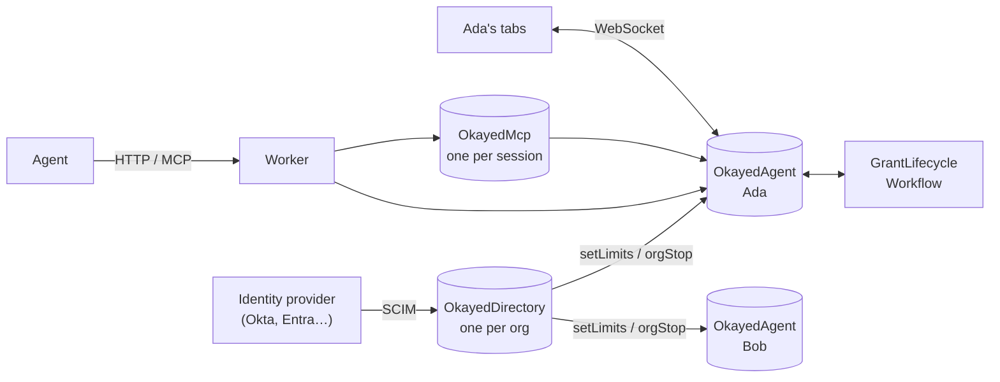
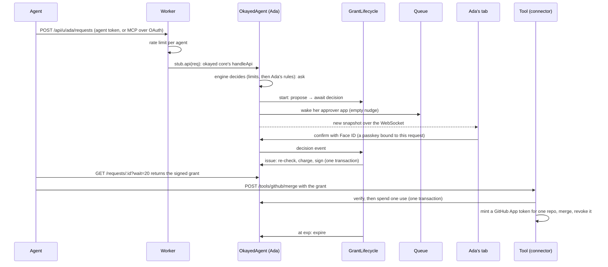

# okayed on Cloudflare

The core (`packages/core`) runs anywhere with the Fetch API. This page covers how the Cloudflare deployment uses
the platform: what each piece does, why it was the right one, and what okayed would need without it. The heart of
it is the Durable Object.

## What a Durable Object is

A Durable Object is a class you write, which Cloudflare runs **one instance of per name, worldwide**. Ask for
`env.OkayedAgent.idFromName("6c16b445…")` from any Worker in any data center, and you reach the same single
instance. Each instance has:

- **Its own storage**, transactional and strongly consistent, on SQLite on the machine that runs it. Reads and writes
  are local calls, not network round trips.
- **One thing at a time.** Requests to an instance are handled in order. While a storage call is in flight, the
  runtime holds new events at the door (the *input gate*). Responses wait until writes are durable (the *output
  gate*). Code that reads, decides and writes can't be interleaved with another request's.
- **A life of its own.** It starts on its first request, keeps WebSockets open (and *hibernates* between messages
  without dropping them), sets alarms, and is evicted when idle. Its storage stays.
- **An address before it exists.** Naming an instance creates it. Something can be written for a person before they
  ever sign in.

Think of it as a small server plus its own database for each person, which nobody else's traffic ever contends
for. A conventional backend gets the same effect from a shared database, row locks or a distributed lock service,
and per-tenant scoping that every query has to get right.

## Why okayed is built on one

Every guarantee okayed makes is about **one person's state, changed by many parties at once**: agents filing
requests, tools spending grants, the person confirming on two devices, the Workflow expiring things, the
organization's directory pulling access. Each guarantee needs a single writer for that person:

| Guarantee | What could go wrong | How the Durable Object prevents it |
|---|---|---|
| **Once means once** | Two tools race to spend a one-use grant, and both succeed | `verify` with `consume` reads `used`, checks and increments it in one transaction. The second call sees the first one's write, so ten parallel tries get exactly one success (tested). |
| **Limits hold** | Parallel auto-approvals each see "29 of 30 left" | Deciding and charging happen in the same transaction as issuing |
| **Stop is total** | A grant is issued after Stop everything, in a gap between reading and writing | `stop` revokes and pauses in one transaction. `issue` re-checks `paused` inside its own transaction. |
| **What you confirm is what's issued** | The card changes between showing and confirming | `issue` re-reads the card, the request and every rule inside its transaction, and closes the card instead of issuing if anything moved |
| **Live state** | Tabs show stale cards | The person's object holds their tabs' WebSockets and pushes each new snapshot (Agents SDK `setState`) |
| **Isolation** | A query forgets a `WHERE user_id = ?` | There's no shared table. Each person's object can only see its own storage. |
| **Limits before sign-in** | A new hire's first session predates their limits | The directory writes their organization's limits into their object, by name, the moment they're provisioned |

Without Durable Objects, the Node runtime gets the first five from one process and SQLite: one writer, with each
person's transactions in a queue (`apps/node/src/sqlite.ts`). That's fine on one machine. Across machines it needs
a lock service or `SELECT … FOR UPDATE` on a shared Postgres. On Cloudflare there's nothing to run.

The trade-offs are real but small for okayed. An object lives in one location, near where it was first used, so
a person far from it pays some latency. Its throughput has a ceiling, roughly hundreds to a thousand small requests
a second per person, far beyond what one person's agents need. And a question across people (everyone in a group)
means fanning out to each person's object, which is why the directory has its own object.

## okayed's four Durable Objects

| Class | One per | It holds | Why it's a Durable Object |
|---|---|---|---|
| `OkayedAgent` (`apps/worker/src/agent.ts`) | person | rules, limits, requests, cards, grants, use counts, audit, passkeys, paired approvers | the single writer behind every guarantee above, and the live-state WebSocket |
| `OkayedChat` (`apps/worker/src/chat.ts`) | person | the demo chat's messages (Agents SDK `AIChatAgent`) | its history and resumable streams, apart from okayed's own state |
| `OkayedMcp` (`apps/worker/src/mcp.ts`) | MCP session | a remote MCP client's session (Agents SDK `McpAgent`) | streamable HTTP needs each session to land in one place |
| `OkayedDirectory` (`apps/worker/src/directory.ts`) | organization | SCIM users and groups | the single writer for who's in which group. Each change fans out to the people it touches. |

## One request, through Cloudflare

The Workflow handles waiting. The Durable Object holds the truth. Revoking takes effect in the object at once, and
the Workflow just ends early when it hears. Verifiers check `exp` themselves too, so a stalled Workflow can never
extend a grant.

## Every Cloudflare piece, and what it's for

| Piece | Binding | What okayed uses it for | Plan |
|---|---|---|---|
| Workers + Static Assets | `ASSETS` | one Worker serves the web app, the playground (`/playground`) and the shadcn registry (`/r`) | Free |
| Durable Objects (SQLite) | `OkayedAgent`, `OkayedChat`, `OkayedMcp`, `OkayedDirectory` | above | Free |
| Workflows | `GRANT_LIFECYCLE` | propose → await decision → issue → await revoke or expiry, durable across restarts | Free |
| Workers AI | `AI` | Llama 3.3 drafts what people say into a proposal (never a decision); Whisper hears voice okays | Free allocation |
| AI Gateway | `AI_GATEWAY` | logs, caching and rate limits for every model call | Free |
| KV | `OAUTH_KV` | OAuth clients, codes and tokens for remote MCP (`workers-oauth-provider`) | Free |
| Queues | `APPROVER_WAKE` | wakes paired approver apps without holding up a request | Free since Feb 2026 |
| Rate limiting | `SIGNUP_LIMIT`, `AGENT_LIMIT` | sign-ups per address, requests per agent | Free |
| Analytics Engine | `METRICS` | one data point per decision | Free |
| R2 | `ARCHIVE` | an archive of every signed event | Needs billing enabled, so off by default (on locally) |
| Access | `ACCESS_TEAM`, `ACCESS_AUD` | sign-in, with groups from any IdP behind it (including SAML ones) setting organization limits | Free up to 50 users |
| Turnstile | `TURNSTILE_SECRET` | a challenge on account creation | Free |
| API tokens | `CF_API_TOKEN` | per-call tokens for real deploys and DNS changes: only the permission needed, deleted after | Free |
| Workers Logs | `observability` | logs for every request | Free allocation |

Only the Durable Objects, the Workflow and `ISSUER_SECRET` are required. Everything else is configuration.

## The same core, other runtimes

The Cloudflare pieces are adapters behind okayed's ports, which is why `apps/node` can run the same core:

| Port | On Cloudflare | On Node |
|---|---|---|
| `Store`: one person's transactional state | `DurableStore` on Durable Object storage | `SqliteStore` on `node:sqlite`, one queue per person |
| `Lifecycle`: durable waiting | `GrantLifecycle` on Workflows | `InlineLifecycle` on timers (a restart forgets them) |
| `Notifier`: wake approver apps | `QueueNotifier` on Queues | none (apps poll) |
| `Drafter`: words into a proposal | Workers AI, through AI Gateway | any OpenAI-compatible model, or the heuristic |
| Person identity | Access, or any OIDC provider | any OIDC provider |
| Organization directory | `OkayedDirectory` | a `ScimDirectory` on the same SQLite |

## Running it

`pnpm dev:local` runs the Worker under `wrangler dev --env local`. Durable Objects, Workflows, KV, Queues, R2 and
the rest are simulated on your machine, with the heuristic interpreter instead of Workers AI, so it needs no
Cloudflare login. `pnpm --filter @okayed/worker run deploy` builds the site and ships the one Worker. Wrangler
creates the KV namespace and you create the queue. Set `ISSUER_SECRET`, plus any of the optional secrets.

## Where to start reading

`apps/worker/src/index.ts` (OAuth wraps everything), `api.ts` (routing to each person's object), `agent.ts` (the
person's object: okayed core with Cloudflare's pieces as hooks), `workflow.ts` (the lifecycle), `directory.ts`
(SCIM), then `packages/core/src/service.ts` for what every transaction does.
